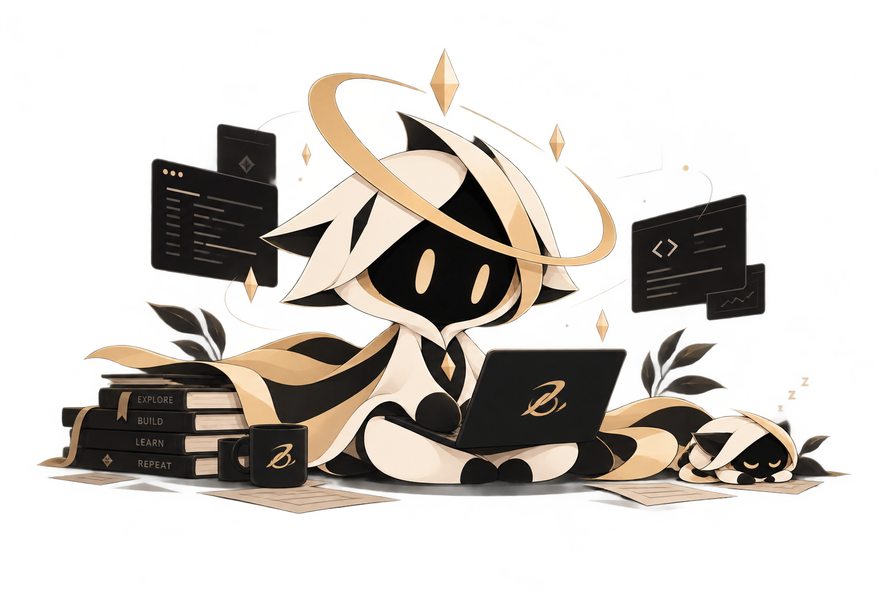

  <picture>
    <source media="(prefers-color-scheme: dark)" srcset="Assets/zenoska-banner-dark.svg">
    <source media="(prefers-color-scheme: light)" srcset="Assets/zenoska-banner-light.svg">
    
  </picture>

<h1 align="center"><b> SOVEREIGN MACHINE COGNITION </b></h1>
<!-- <h3 align="center">Local-First Cognitive Environments & Bare-Metal Systems</h3> -->

 

<table>
  <tr>
    <td width="46%" align="center" valign="middle">
      
    </td>
    <td width="54%" valign="middle" style="padding-left: 20px;">
      

        <strong>OSKA</strong> (on GitHub as <code>ZenOska</code>) builds local-first software and personal machine intelligence.
      

      

        Our focus is <strong>Sovereign Machine Cognition</strong>: software that reasons and holds state while running directly on your hardware. No cloud dependencies, no background telemetry, and no remote control.
      

      

        We write software to see how modular tools combine into capable systems. Most projects start with an open engineering question rather than a finished blueprint.
      

      

        OSKA is an active work in progress, shaped by ongoing code, real benchmarks, and daily use.
      

    </td>
  </tr>
</table>

## The principles

<table>
  <tr>
    <td width="50%" valign="top" style="padding: 14px;">
      <b><code>01</code> &nbsp; Intelligence is engineered.</b>
        
      Cognition is an engineering problem. We explore it by building working code, not abstract theories.
    </td>
    <td width="50%" valign="top" style="padding: 14px;">
      <b><code>02</code> &nbsp; Autonomy begins with control.</b>
        
      You cannot trust software you cannot inspect. We want full clarity on where our code runs and what it depends on.
    </td>
  </tr>
  <tr>
    <td width="50%" valign="top" style="padding: 14px;">
      <b><code>03</code> &nbsp; Complexity should compose.</b>
        
      Small, focused modules should combine cleanly without sacrificing readability or maintainability.
    </td>
    <td width="50%" valign="top" style="padding: 14px;">
      <b><code>04</code> &nbsp; Ideas must become artifacts.</b>
        
      Theory matters, but working software proves it. An implementation teaches what speculation cannot.
    </td>
  </tr>
</table>

  
  &nbsp;&nbsp;
  

  <i><b>Managed by the OSKA Engineering Team • Sovereign Computing Environments</b></i>
   
  Independent by intent. Experimental by nature.

